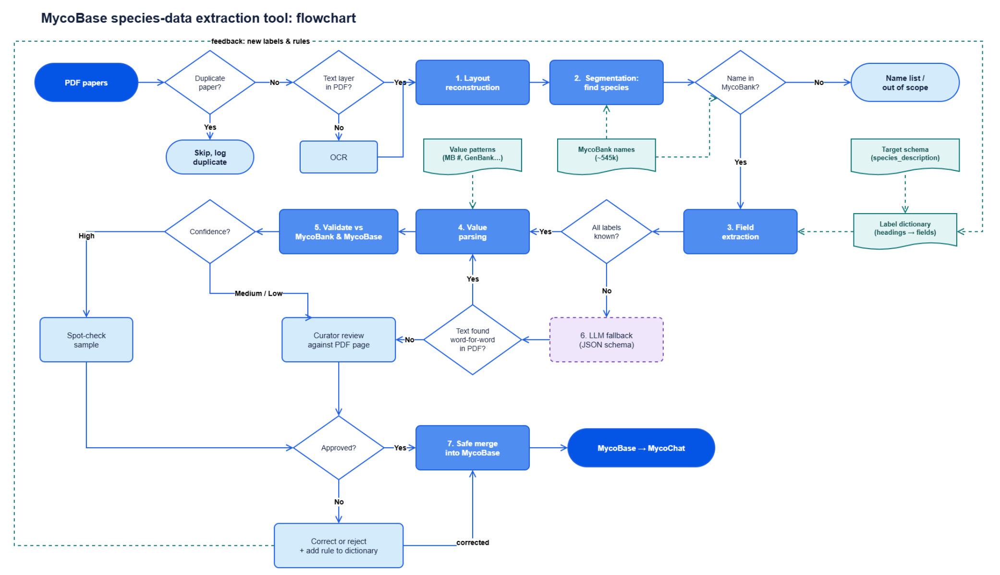

# MycoBase extraction

A tool that extracts structured species data from taxonomic papers (*Studies in Mycology* and
similar journals) into **MycoBase**, the species database behind **MycoChat**.

The goal is to replace most of the manual work of copying species descriptions out of PDFs, while
keeping the data accurate enough for curated use: every value can be traced back to its paper and
page, and anything uncertain goes to a curator instead of straight into MycoBase.



## Scope rule

MycoBase contains only species **accepted in Visagie et al. 2025**, *From chaos to tranquillity:
a modern approach to the identification, nomenclature and phylogeny of Aspergillus, Penicillium
and other Eurotiales — updated accepted species list* (Studies in Mycology 112). In
`data/species_description.json` these are the records with `"is accepted": "Yes"`.

The tool still extracts **everything** from a paper, in two layers:

| layer | contains |
|---|---|
| raw output (`output/`) | every species section found, whatever its name status |
| MycoBase | only accepted species, plus old names (synonyms) that MycoBank maps to an accepted species; on a conflict the accepted list wins |

Each section's name is checked against the accepted list and the MycoBank name list (~545,000 names):

| status | meaning | goes to |
|---|---|---|
| `accepted` | on the accepted list | MycoBase |
| `synonym` | MycoBank's current name for it is accepted | MycoBase, under the accepted name |
| `not_accepted` | in MycoBank, but not leading to an accepted species | raw output only |
| `unknown` | not in MycoBank (new, misspelled or out of scope) | raw output only |

## Status

| step | what it does | status |
|---|---|---|
| intake | skip duplicate PDFs (same content, other file name); flag scanned PDFs | done |
| 1. Layout reconstruction | PDF → clean text in reading order, with font size, bold, italic | done |
| 2. Segmentation | find where each species section starts and ends; resolve its name | done |
| figures | save every figure as an image, attach the species it shows | done |
| OCR | text for scanned PDFs (e.g. volume 45) | to do |
| 3. Field extraction | split a section into fields (Etymology, Typus, Colony diam, ...) with `config/label_dictionary.json` | done |
| 4. Value parsing | MYCOBANK, Literature, YEAR, TYPUS, EX_TYPUS, GenBank IDs, section, colony diameters | done |
| 5. Validation | confidence (high / medium / low) for every proposed MycoBase addition; review queue | done |
| 6. LLM fallback | only for sections with unknown labels; answer must be found word-for-word in the PDF | to do |
| 7. Safe merge | curator-approved records into MycoBase, keeping the source paper and page | to do |

Results on four test papers (Chen 2017, Talaromyces 2016, Samson 2007, Visagie 2014): all 100
species treatments found, 141 figures saved, every treatment linked to its own figure.

## Repository layout

```
config/
    label_dictionary.json      paper headings -> MycoBase fields (edit here, no code change)
data/
    species_description.json   current MycoBase (1,609 species; 1,486 accepted)
    excel/                     Mycobank.xlsx (not in git), comparison report, MycoBase as CSV
    illustations/              pipeline diagram and analysis plots
    images/                    species images used by MycoChat
    cache/                     MycoBank name index (built by the tool, not in git)
src/
    01_test_data.ipynb         exploration of the current MycoBase data
    02_compare_mycobank.py     compare MycoBase with MycoBank (names and MycoBank numbers)
    03_plot_comparison.py      plot that comparison
    04_convert_json_to_csv.py  species_description.json -> CSV
    05_plot_columns.py         plot which columns MycoBase has and how full they are
    06_run_steps.py            the extraction tool: steps 1-4 and species images (command line)
    07_check_mycobank.py       check the extracted names against MycoBank (OK / CHECK per species)
    08_plot_results.py         charts of the results
    09_compare_fields.py       compare the step-3 fields with the current MycoBase, field by field
    10_compare_values.py       compare the step-4 values with the MycoBase backbone columns
    11_fill_gaps.py            propose what MycoBase is missing - never replaces MycoBase data
    12_validate.py             step 5: confidence (high / medium / low) for every proposed addition
    extraction/
        text.py                text and style helpers, label detection
        layout.py              step 1: PDF -> clean lines in reading order
        segment.py             step 2: species sections, kind, name status, target
        names.py               accepted list + MycoBank name index, name resolution
        figures.py             species images (plates), named after the species
        fields.py              step 3: section -> MycoBase fields
        values.py              step 4: fields -> MycoBase backbone values (TYPUS, EX_TYPUS, GenBank IDs ...)
tests/
    test_steps_1_2.py          regression tests on real papers
studies_in_mycology/           the PDF papers (not in git)
aidscripts/                    the earlier per-journal extraction scripts (not in git)
output/                        tool results (not in git)
```

## Setup

Python 3.10 or newer.

```bash
python -m venv venv
venv\Scripts\activate            # Windows  (macOS/Linux: source venv/bin/activate)
pip install -r requirements.txt
```

Files that are not in git and must be put in place by hand:

* `studies_in_mycology/` — the PDF papers
* `data/excel/Mycobank.xlsx` — the MycoBank export (columns: ID, Taxon name, Authors, Rank, Year,
  Name status, MycoBank #, ..., Current name)

Then build the MycoBank name index once (about 1 minute; it is cached in `data/cache/`):

```bash
python src/06_run_steps.py --build-mycobank-index
```

## Usage

```bash
# one paper
python src/06_run_steps.py --pdf "studies_in_mycology/Vol84Art2_New-Talaromyces-species-from-indoor-environments-in-C_2016_Studies-in-Mycolo.pdf"

# a whole folder
python src/06_run_steps.py --pdf studies_in_mycology

# options
#   --out DIR         output folder (default: output/)
#   --no-figures      do not save figure images (faster)
#   --fig-dpi N       resolution of figure images (default: 150)
#   --tables          also remove ruled tables from the text (slower)
```

### Compare the fields with the current MycoBase

```bash
python src/09_compare_fields.py --out output_vol84
```

For every extracted species that is a MycoBase record, each description field is marked `same`,
`close`, `partial`, `different` (often: MycoBase took the text from another publication), `new`
(MycoBase is empty - step 3 fills a gap) or `missed`. Result: `<out>/fields_vs_mycobase.tsv`.

### Fill the gaps in MycoBase (never replace)

MycoBase is the trusted reference. `11_fill_gaps.py` only proposes data that MycoBase does not have:

```bash
python src/11_fill_gaps.py --out output_sim59 --out output_vol84
python src/11_fill_gaps.py --out output_sim59 --write-copy     # also a filled copy as a NEW file
```

* only accepted MycoBase records are filled; a species under an old name fills its accepted record
  (descriptions, culture numbers, GenBank IDs only - not the old name's MycoBank number or citation)
* a column is filled only when MycoBase has no value for it under any of its column names
* MycoBase's own column names and formats are used
* if two papers give different text for the same empty column, both are listed as `conflict`
* `data/species_description.json` is only read (its checksum is checked before and after)

Results: `mycobase_additions.csv` (one row per addition, with paper and pages for checking),
`mycobase_additions.json`, and with `--write-copy` `species_description_filled.json`.

### Validate the additions (step 5)

```bash
python src/12_validate.py --out output_sim59 --out output_vol84 --additions output_additions
```

Every species and every proposed addition gets a confidence:

* **identity** - is the paper section really this MycoBase species? Confirmed by the same MycoBank
  number, a shared ex-type culture or a shared GenBank ID; a difference is an identity conflict
* **quality** - unreadable characters, a field that ran into the next one (another label or species
  heading inside it), badly formatted values, an image caption naming another species, papers that disagree

`high` = identity confirmed and no problem; `medium` = nothing wrong but not confirmed; `low` = a
conflict or a problem. `review_queue.csv` lists only the medium and low rows - the curator's to-do list.
Also written: `validation_species.csv`, `additions_validated.csv`, `images_validated.csv`.

### Compare the values with the MycoBase backbone

```bash
python src/10_compare_values.py --out output_vol84
```

MYCOBANK, YEAR, Literature, TYPUS, EX_TYPUS, the four GenBank IDs and section are compared with the
accepted MycoBase record: `same`, `agree` (same content written differently, e.g. extra culture
numbers), `different` (to check), `new`, `missed`. Result: `<out>/values_vs_mycobase.tsv`.

### Check the names against MycoBank

```bash
python src/07_check_mycobank.py                    # checks output/
python src/07_check_mycobank.py --out output_vol84 # or another output folder
```

For every species section it checks that the name is in MycoBank (and suggests close names when it is
not), that the MycoBank number printed in the paper belongs to that name, that MycoBank's authors and
year match the heading, and what MycoBank's current name is. Each section gets `OK` or `CHECK` with
the reasons; the result is `<out>/mycobank_check.tsv`.

## Output

| file | contents |
|---|---|
| `output/<paper>/clean_text.txt` | step 1: every clean line as `p<page> c<column> <size>pt \| text`, with `**bold**` and `_italic_` — to check the layout by eye |
| `output/<paper>/sections.json` | step 2: one entry per species section — name in the paper, name status, accepted name, `treatment` or `name_entry`, target (`mycobase` / `raw_only`), pages, MycoBank number, labels found, body text, its figures |
| `output/<paper>/figures/` | every figure as an image: `fig06_p12.jpg` = Fig. 6 on page 12 |
| `output/<paper>/figures.json` | per figure: number, page, kind (plate / phylogeny / drawing), caption, main species, species in the caption and in tree labels |
| `output/species_fields.csv` | step 3: one row per species treatment, one column per MycoBase field (opens in Excel) |
| `output/species_values.csv` | step 4: MYCOBANK, Literature, YEAR, TYPUS, EX_TYPUS, GenBank IDs, section, colony diameters per species |
| `output/labels_report.tsv` | step 3: every label found in the papers, its MycoBase field, how often; labels not in the dictionary first |
| `output/sections_summary.tsv` | all sections of all papers in one table (opens in Excel) |
| `output/figures_summary.tsv` | all figures of all papers in one table |
| `output/run_stats.json` | per paper: ok / duplicate / needs OCR, counts, time |

Example section (shortened):

```json
{
  "species": "Talaromyces aerius",
  "nomenclature": "Talaromyces aerius A.J. Chen, Frisvad & Samson, sp. nov. MycoBank MB817398. Fig. 6.",
  "mycobank_in_paper": "817398",
  "pages": [6, 6],
  "kind": "treatment",
  "name": {"status": "accepted", "accepted_name": "Talaromyces aerius"},
  "target": "mycobase",
  "figures": [{"figure": 6, "page": 12, "file": "figures/fig06_p12.jpg", "how": "heading cites figure"}]
}
```

How steps 1 and 2 and the figure step work in detail: see [README_steps_1_2.md](README_steps_1_2.md).

## Tests

```bash
python -m pytest -q tests
```

The tests run on real papers in `studies_in_mycology/`; a test is skipped when its PDF is missing.
They check, for example, that running headers are removed, hyphenated words are joined, the right
species are found in each paper, a MycoBank number on the second heading line is read, and each
species gets its own figure.

## Known limits

* Scanned PDFs without a text layer are reported as `needs OCR` and skipped.
* Species mentioned only in a Notes paragraph, without a bold heading, are not found.
* MycoBank still lists some old names (e.g. *Neosartorya*) as current; they come out as
  `not_accepted` and need a curator, or a rule, to map them to the *Aspergillus* name.
* Tree labels in a tree pasted in as a picture cannot be read without OCR.
* Scripts `02`–`05` read their input from `data/`; the Excel and CSV files now live in
  `data/excel/`, so adjust the paths at the top of those scripts if you run them.

## Data sources

* *Studies in Mycology* papers (Westerdijk Fungal Biodiversity Institute)
* MycoBank — www.mycobank.org
* Visagie et al. 2025, accepted species list, Studies in Mycology 112: 117–260
